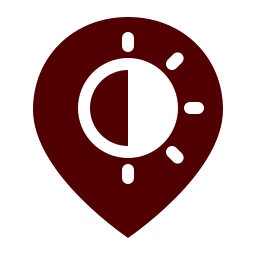

<p align="center"></p>

# SunScreen: extended docs

SunScreen finds shady walking routes anywhere on Texas A&M's main campus and the nearby neighborhoods (Northgate, Southside and West Campus). Pick a start and destination from 401 campus destinations, search for an address, drop a pin, or use your location. For any time from 7 AM to 8 PM it shows three routes: the fastest route, a recommended route that adds only a minute or so but has more shade, and the shadiest route that isn't too long.

**Live demo:** [sunscreen-walks.vercel.app](https://sunscreen-walks.vercel.app). It's the web app plus the routing API, deployed together on Vercel with `make deploy`.

## How it works

1. `01_area` geocodes 24 campus places and sets the routing area to their extent plus 400 m. The map can't pan or zoom out past that area.
2. `02_lidar` downloads the TxGIO StratMap 2025 LiDAR tiles for the area (falling back to USGS 3DEP) and builds 1 m ground (DTM), surface (DSM) and canopy-height (CHM) rasters.
3. `03_shade` uses pvlib to place the sun every 30 minutes from 7:00 to 20:00 and traces shadows from every roof and tree. Anything under cover taller than 2.5 m always counts as shaded.
4. `04_graph` samples those shade masks every 2 m along each OpenStreetMap footpath.
5. The API pulls today's Open-Meteo forecast. It measures sunlight strength by comparing the forecast's direct sunlight with clear-sky sunlight (pvlib Ineichen model), so heavy clouds make shade matter less.
6. The API runs Dijkstra with several shade weights and picks three routes:
   - **Fastest:** the shortest path.
   - **Recommended:** the shadiest route within +10% distance, scaled down by sunlight strength.
   - **Max shade:** the shadiest route within +30% distance.
7. **Open in Google Maps** hands the selected route to Google Maps for turn-by-turn walking directions. It passes three waypoints along the route, which is Google's limit on phones, so Google follows the shady path. **Apple Maps** URLs can't carry waypoints, so Apple gets the same start and destination and picks its own path.

## Using the app

- **Campus search:** type an official code such as ILSQ/ILCB, a building number,
  a dorm/dining name or an alias such as Buetul. Suggestions appear immediately;
  Enter selects a unique match. There are 401 preloaded destinations, including
  58 residence destinations and Commons/Sbisa/Duncan/West Campus dining. See
  [campus destinations](docs/campus-places.md) for coverage and refresh commands.
- **Route settings:** tap the gear beside Night mode to adjust extra walking
  distance for Recommended and Max shade / Most lit. Defaults are 10% / 30%.
  Each limit can range from 0% to 100%; the maximum route's allowance must be at
  least Recommended's. Apply recalculates routes, Cancel discards edits, and
  Reset restores the defaults. Settings persist in this browser; native keeps
  them for the current session. See [route settings](docs/route-settings.md).
- **From / To:** opens a picker with campus places grouped by type, your recent picks, distances once you've shared your location, address search, **My location** and **Pick on map**. The ⇅ button swaps the two.
- **Map:** the selected route is colored segment by segment from shade (maroon) to sun (gold). The fastest route is dashed gray, and the third route is drawn thinner.
- **Custom endpoints:** drag either endpoint pin to choose a custom start or destination; routes recalculate when you release it. In the native app, long-press a pin to drag it. Pins stay available while routing loads or fails, so you can adjust an unroutable location. Drops must stay inside the mapped campus area, and each endpoint must be within 250 m of a mapped walkway node with a connected walking route between them.
- **Night mode:** routes by streetlight coverage (see [night routing](#night-routing-with-public-lighting-data)), with `#A00000` UI accents and lighter red/copper walking paths. Its **Call Corps escort** button opens the phone app for **979-845-6789**, even when routing is unavailable. Texas A&M lists service hours as weekdays 6 p.m.–7 a.m. and all day on weekends during fall and spring semesters ([official campus safety information](https://www.tamu.edu/campus-community/campus-safety.html)).
- **Time:** drag the slider, tap **Now**, or tap **Play day** to step through the day while the routes redraw.
- **Routes card:** on phones it shows the selected route; tap or swipe the handle to compare all three. Pick a route, then hand it off with **Open in Google Maps** or **Apple Maps**.
- **ⓘ:** a short "How SunScreen works" explainer. It opens on the first visit to the website; add `?intro=0` to the URL to skip it.
- **Wide screens** (900 px and up) put the controls in a side panel next to a full-height map.

## Setup

For the checked-in routing data, use Python 3.12 and Node 22. You do not need to
rerun the LiDAR pipeline to try this feature. From the repository root, start
the API in one terminal:

```sh
python -m pip install -r requirements-dev.txt uvicorn
python -m uvicorn api.index:app --host 127.0.0.1 --port 8000
```

In another terminal:

```sh
cd app
npm ci
npx expo start --web
```

Open the local URL printed by Expo. Local web uses the API on port 8000.
The feature is in the normal route choices, so choose endpoints and a time as
usual. Building coverage, validation commands and limitations are documented in
[building passages](docs/building-shortcuts.md). A remote feature branch is not
automatically the production Vercel site; use its Vercel preview if configured.

Rebuilding the LiDAR data additionally needs
[Miniforge](https://github.com/conda-forge/miniforge) for PDAL and GDAL:

```bash
conda create -n shade -c conda-forge python=3.12 pdal python-pdal make --file pipeline/requirements.txt
conda activate shade
```

Run these from the repo root:

```bash
make data     # ~45 min the first time: geocode, ~700 MB LiDAR download, shadows, graph -> data/
make refresh  # re-cast shadows for today's sun and rebuild the graph (reuses the LiDAR)
make bake     # bundle app/places.json and the offline routes in app/fallback.json
make api      # http://localhost:8000/api/route?time=14:00&from=commons&to=zachry
make web      # the app in a browser, using the local API
make app      # Expo dev server; scan the QR code with Expo Go
make deploy   # web app + API to Vercel (pushes to main also redeploy; link once: npx vercel link)
```

Check the API with:

```bash
curl "localhost:8000/api/route?time=14:00&from=msc&to=zachry"
```

## API

### Building passages in the normal search

Every normal `/api/route` request automatically considers mapped building
passages and covered outdoor paths. It returns exactly three options: Fastest,
Recommended, and Max shade. No indoor setting, separate route, floor picker or
room destination is required. The existing distance limits still apply.

The catalog includes a provisional Langford A corridor and 22 matched
covered-walkway/roof records across campus. Current Langford door access, exact
geometry and opening hours are unverified; a compact access notice appears if
it is selected. Scheduled closures are checked through estimated traversal.
Offline routes exclude enclosed door-dependent passages. More interiors require
documented entrance-to-exit paths before being added.
See [building passages](docs/building-shortcuts.md) for sources and tests.

### Existing endpoints

Every endpoint is served at both `/x` and `/api/x`.

`/route` also accepts `recommended_pct=10&max_detour_pct=30` in shade and
lighting modes. Values must be finite percentages in [0, 100], with
`recommended_pct <= max_detour_pct`. They are extra-distance caps relative to
Fastest, not target shade or lighting percentages. Daytime Recommended's cap
is still scaled down by sunlight strength. The response echoes the applied
values and effective Recommended cap in `route_limits`. Older offline bundles
only support defaults; custom settings require the live API.

- **`/route`:** takes `time=HH:MM` (snapped to the nearest 30-minute slot), plus `from` and `to`. Each endpoint can be a place id from `/places` or `lat,lon`, and `from_name` and `to_name` label custom points. The response is GeoJSON with three LineStrings: `fastest`, `recommended` and `max_shade`. Each one includes `distance_m`, `time_min` (at 1.4 m/s), `extra_s`, `shaded_pct`, `sun_min`, and `runs`: one `[first coord, last coord, shade]` entry per path segment, which the app uses to color the route from shade (maroon) to sun (gold). The response also includes the sun's position and the weather for that slot.
- **`/places`:** the campus places and the bounds of the routing area.
- **`/search?q=`:** a Nominatim search limited to the routing area.

Points outside the area, or more than 250 m from any walkway, get a 400 response with a plain-English reason that the app shows.

## Phone setup

Hosted web builds use their own `/api`, so a Vercel preview of `night-mode` uses
the lighting API and graph from that branch. Leave `EXPO_PUBLIC_API_BASE_URL`
unset on Vercel. No local server is needed by the deployed app.

For local web development, copy `app/.env.example` to `app/.env.local` before
starting Expo; its optional API override points at `http://localhost:8000`.
Expo Go uses the hosted API by default. To use your own API from a phone, set
`EXPO_PUBLIC_API_BASE_URL` in `app/.env.local` to your laptop's LAN IP, for example
`http://192.168.1.23:8000`. The phone and laptop must be on the same Wi-Fi network,
and port 8000 must be allowed through the firewall. Restart Expo after changing
the setting; public Expo variables are embedded at build time.

If the API is unreachable, the app falls back to the bundled routes for The Commons → Zachry and labels them as offline.

## Data notes

- **LiDAR source:** TxGIO StratMap 2025 (Little/Middle/Lower Brazos basins), flown January–March 2025 and classified with vegetation (classes 3–5) and buildings. It was flown in winter, so deciduous trees are bare and their shade is undercounted; live oaks keep their leaves. If TxGIO is unreachable, `02_lidar` says so and uses the USGS 3DEP `TX_RedRiver_3Area_B2_2018` EPT, which has no vegetation classes. `.laz` files already in `data/raw/` are always used first.
- **Trees:** canopy is treated as fully opaque.
- **Shadow date:** shadows are cast for the day `03_shade` runs, while weather is always today's. The sun's noon height changes by about 5° every two weeks in autumn, so run `make refresh` before a demo. To use another date, run `python pipeline/03_shade.py --date 2026-06-21`.
- **Weather fallback:** if Open-Meteo is unreachable, the API logs it and assumes a clear sky, and the app shows "weather unavailable".
- **Places:** Nominatim doesn't know "The Commons", so it's geocoded as "Commons Dining Hall". `01_area` drops any geocode that lands outside the campus box (some names match buildings in other states). To override a place, run `python pipeline/01_area.py --place id=lat,lon`. Routes start at the nearest footpath node, and the map shows that gap as a dashed line.
- **Windows:** keep the conda install path short. Deep package paths can exceed the 260-character limit.
## Night routing with public lighting data

Night mode selects `mode=lighting` on `/api/route`; turning it off restores the
existing `mode=shade` behavior. The lighting scorer does not use shade fractions,
solar time slots, or weather. The night model assumes ordinary dusk-to-dawn lamps
are on; it is not a live outage feed or a measurement of illuminance.

After the walking graph exists, run:

```sh
python pipeline/05_lighting.py
```

The script combines the public TAMU Streetlight inventory and historical passing
lighting surveys with OpenStreetMap data inside the routing boundary plus a 40 m
buffer. `pipeline/lighting_sources.py` downloads complete ArcGIS snapshots by
object ID, requests only lamp physical/status fields, and rejects incomplete or
duplicate pages. It excludes removed/non-existing fixtures, sign-only poles,
out-of-envelope points, unsupported survey types and non-passing historical
inspections. Failed inspections are not interpreted as current lamp outages.
Sources are deduplicated within 3 m, preferring current inventory, then survey,
then OSM; newer removed locations suppress older positive observations nearby.

Campus snapshots are cached under `data/lighting/cache/` for up to 30 days, keyed
by source URL, field schema and buffered boundary. A valid older snapshot can be
retained on refresh failure, with its original timestamp and an explicit error in
the metadata. If the main inventory is unavailable with no matching cache, the
pipeline retains the existing graph rather than silently downgrading it.

The OSM response is cached in `data/lighting/osm.raw`. It downloads
`highway=street_lamp` nodes and `lit` tags on highway ways. If Overpass is
unavailable, it tries a second public instance and then the bounded OSM map API.
Downloads run only during preprocessing, never during route requests. To refresh
OSM and campus snapshots rather than use the caches:

```sh
python pipeline/05_lighting.py --refresh
```

For a previously downloaded Overpass JSON or OSM XML extract, use
`--input path/to/extract.osm`. `--osm-only` explicitly omits campus inventories
for a baseline audit. `--radius 12` configures the pilot lamp influence
radius in meters (default 12, maximum 50). This radius requires local validation.
Known disused/broken lamps and unsupported operating schedules do not contribute
to the proximity estimate.

Each directed walkway is sampled at equal-length intervals of at most 2 m.
Samples within 1 m of a way tagged lit/unlit use that evidence. Samples within
the lamp radius are estimated lit; unsupported or missing evidence remains
unknown. Conflicting lit/unlit evidence is explicitly classified as conflict.
The estimate does not yet model buildings, canopy, lamp direction, or photometry.
Co-located OSM ways can conflict; review those locations in the coverage output.

Outputs:

- `data/lighting/lights.geojson`: normalized campus lamp and OSM lamp/way evidence,
  including source IDs and provenance. This retains evidence records; model lamp
  counts in coverage.json are spatially deduplicated.
- `data/lighting/coverage.json`: retrieval time, counts, model parameters, license,
  and length-weighted graph coverage. Directed reciprocal edges are both counted.
- `data/graph.pkl` and `data/graph.geojson`: existing shade data plus per-edge
  lighting fractions and ordered lighting runs.

The API tries positive weighted shortest paths. Relative penalties are mapped
lit=0, estimated lit=0.2, unknown=0.5, conflict=0.6, mapped unlit=1. Recommended
routes may be at most 10% longer than fastest; Most lit at most 30%. Among those
candidates, minimize total penalized meters. These weights and the 10% minimum
route-evidence threshold are pilot heuristics, not a safety score or a global
constrained-optimization guarantee. Below the evidence threshold all alternatives
use the fastest route and return `lighting_status=insufficient_data`. Missing
lighting attributes on an older graph are also treated as unknown.

Night responses include mapped/estimated lit percentages, unknown/unlit/conflict
percentages, the longest continuous uncertain or unlit gap across edge boundaries,
and separate `lighting_runs` for map rendering. They contain no shade percentages
or weather. Ordinary shade responses retain their prior fields and calculations.

`make data` and `make refresh` run lighting annotation after rebuilding the graph.
`make lighting` refreshes lighting without reprocessing LiDAR. Run `make bake`
afterward to update the offline lighting response in `app/fallback-lighting.json`
as well as the existing places/daytime fallback. Local development also needs
the API on port 8000; otherwise only the saved default trip is available offline.
Restart the API after rebuilding the graph; it loads graph data at startup.

The original OSM-only extract on October 24, 2026 contained 30 eligible lamps and
15 tagged ways, leaving 99.4% of walkway length unknown. The expanded public-source
audit found live campus inventories referenced by TAMU's lighting-circuit map.
The combined pipeline now models 7,294 unique lamps: 5,790 inventory locations,
1,477 additional historical survey observations, and 27 additional OSM lamps.
The current 12 m radius models mapped/estimated lit evidence on 39.87% of
directed walkway length, with 60.00% unknown. Sbisa-to-MSC improves from 71%
on fastest to 89% on recommended for +25 seconds. The initial 15 m calibration
covered 49.45% of walkway length and showed 82% versus 93% on that trip.
These are modeled proximity estimates, not measured light levels or live uptime.
See [the full source audit](research/lighting/SOURCES.md) for all evaluated source
families, URLs, actual contribution measurements, rejected sources and access limits.

Data attribution: TAMU campus GIS and
[© OpenStreetMap contributors, ODbL](https://www.openstreetmap.org/copyright).
The TAMU item license fields are blank despite anonymous public query access.
The local prototype retains their attribution and source URLs separately; it
does not label TAMU snapshots as ODbL. Resolve redistribution terms before
publishing those snapshots or a combined database. Preserve the applicable OSM
attribution/license obligations. This task does not publish the app or data.

Run behavioral checks with `python -m unittest discover -s tests -v` (requires
the pipeline dependencies plus `httpx`). These cover mode isolation, API validation,
detour limits, multigraph edge selection, uncertain gaps, empty/incomplete data,
lamp status handling, and classification.
