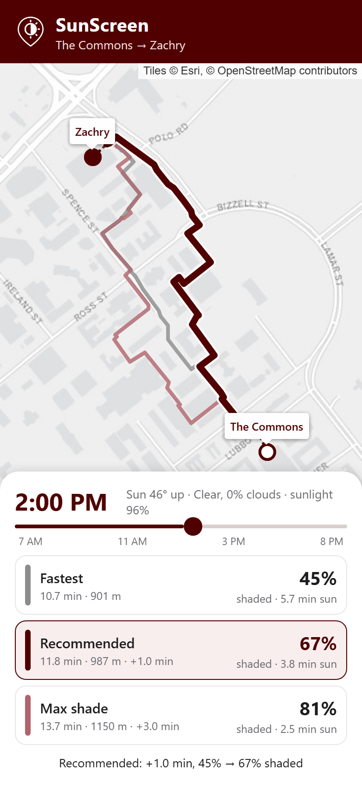
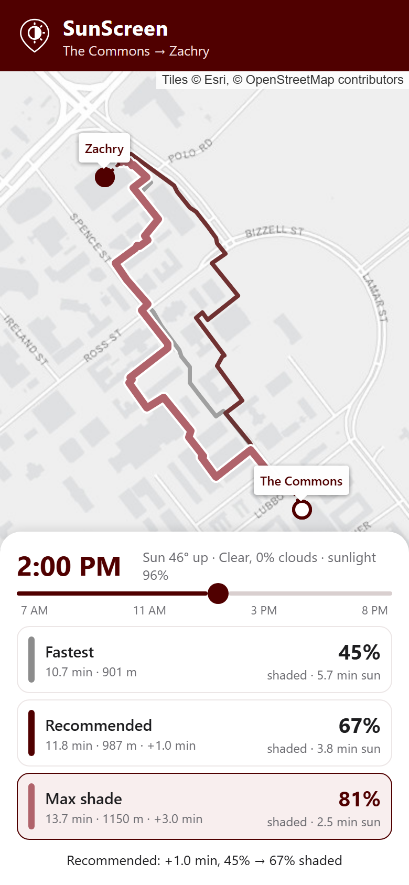
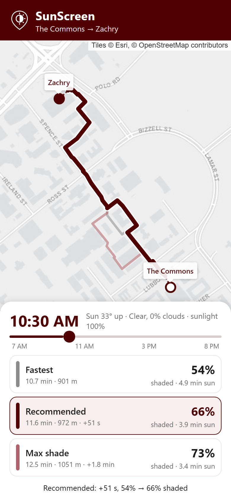
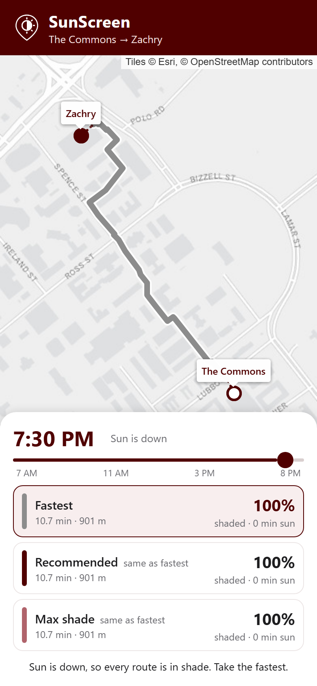

# SunScreen

SunScreen finds the shadiest walking routes across Texas A&M's campus for any time of day. It builds a 3D shadow map from LiDAR using PDAL and pvlib, scores every footpath for shade, adjusts for live cloud cover, and shows routes in an Expo (React Native) app backed by a FastAPI router. Built for Aggies during Howdy Hacks 2026.

- **Team:** Vignesh Nagarajan, Amulya Bisaria, Jayin Palicha
- **Datasets:** [USGS 3DEP LiDAR](https://registry.opendata.aws/usgs-lidar/) (TX RedRiver 2018, via AWS), [OpenStreetMap](https://www.openstreetmap.org/) walking paths (via osmnx), [Open-Meteo](https://open-meteo.com/) cloud and sunlight forecast
- **Stack:** Python (PDAL, rasterio, numpy, osmnx, networkx, pvlib), FastAPI, Expo / React Native, Leaflet for web
- **Run it:** see [EXTENDED.md](EXTENDED.md) for setup, then `make data`, `make api` and `make app`

## Demo

Try it live at **[sunscreen-psi.vercel.app](https://sunscreen-psi.vercel.app)**.

| 2 PM, recommended | 2 PM, max shade | 10:30 AM | 7:30 PM, sun down |
|:-:|:-:|:-:|:-:|
|  |  |  |  |

The demo routes a walk from The Commons to the Zachry Engineering Education Complex. A one-time pipeline turns LiDAR into 1 m height maps, casts shadows from every roof and tree for each half hour from 7 AM to 8 PM, and records how much of each footpath is shaded. The API weighs that shade against the cloud forecast. It returns the fastest route, a recommended route that adds about a minute for noticeably more shade, and a max-shade route; at 2 PM that's 45%, 67% and 81% shaded.

The full pipeline, API and app run end to end on real data, and both the web and native builds compile. The live web demo uses routes and weather saved on October 22, 2026, and the app hasn't been tested on a phone in Expo Go yet. Tree shade is undercounted because the available LiDAR was flown in winter, so newer TxGIO tiles are the next upgrade.
