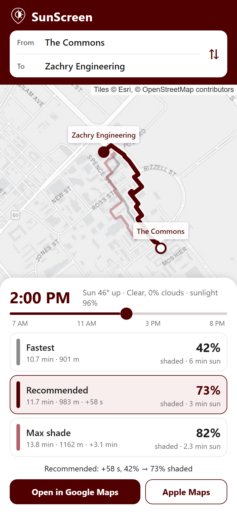
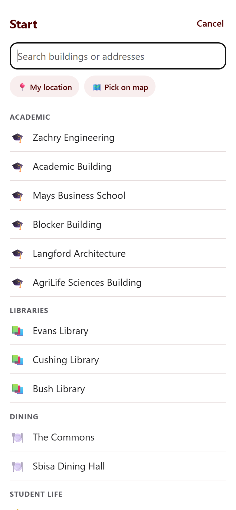
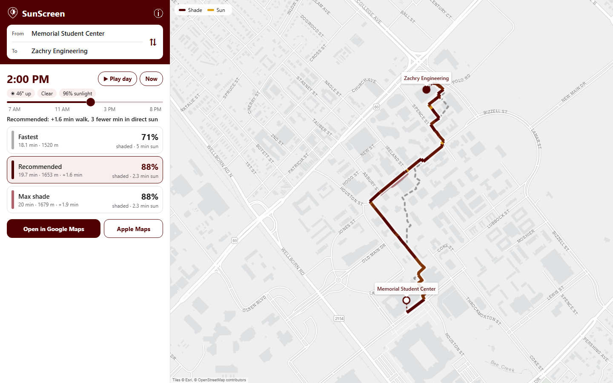

# SunScreen

SunScreen finds the shadiest walking route between any two spots on Texas A&M's campus and the nearby neighborhoods, for any time of day. It builds a 3D shadow map from LiDAR using PDAL and pvlib, scores every footpath for shade, adjusts for live cloud cover, and shows routes in an Expo (React Native) app backed by a FastAPI router. Built for Aggies during Howdy Hacks 2026.

- **Team:** Vignesh Nagarajan, Amulya Bisaria, Abhi Thatavarthi, Jayin Palicha
- **Datasets:** [TxGIO StratMap 2025 LiDAR](https://data.geographic.texas.gov/) (Brazos basins, with [USGS 3DEP](https://registry.opendata.aws/usgs-lidar/) as a fallback), [OpenStreetMap](https://www.openstreetmap.org/) walking paths (via osmnx), [Open-Meteo](https://open-meteo.com/) cloud and sunlight forecast
- **Stack:** Python (PDAL, rasterio, numpy, osmnx, networkx, pvlib), FastAPI, Expo / React Native, Leaflet for web
- **Run it:** see [EXTENDED.md](EXTENDED.md) for setup, then `make data`, `make api` and `make app`

## Demo

Try it live at [sunscreen-walks.vercel.app](https://sunscreen-walks.vercel.app/).

| Shade (maroon) vs. sun (gold) | Places grouped by type | Compare all three routes | How it works |
|:-:|:-:|:-:|:-:|
|  |  |  |  |

You can route between 24 campus places, any searched address, a dropped pin, or your current location, and the map stays locked to campus, Northgate, Southside and West Campus. A one-time pipeline turns 65 million LiDAR points into 1 m height maps, casts shadows from every roof and tree for each half hour from 7 AM to 8 PM, and records how much of each footpath is shaded. The API weighs that shade against today's cloud forecast. It returns the fastest route, a recommended route that adds about a minute for noticeably more shade, and a max-shade route, and any of them can be opened in Google Maps or Apple Maps for turn-by-turn directions. The selected route is colored segment by segment from shade (maroon) to sun (gold), and Play day animates the routes from 7 AM to 8 PM as the sun moves. For The Commons to Zachry at 2 PM, that's 42%, 73% and 82% shaded.

The pipeline, API and app run end to end on real data, and the live site runs the same routing API on Vercel with live weather. Shadow directions were checked against the sun's position on the real campus data and match within a few degrees. The app hasn't been tested on a phone in Expo Go yet, and the LiDAR was flown in January, so deciduous trees cast less shade than they do in summer.
