# UI redesign: iterations and screenshots

Every stage of the SunScreen UI redesign, from the original app to what is on `main` now, with the screenshots that survive from each stage. Images in `iterations/` are reference copies and are not linked from the README.

Stage 1 and the first in-app build (stage 1b) have no saved images: the prototype lives on the design canvas, and the first build's screenshots were overwritten by later test runs. Both are described below.

## Summary

| # | Stage | Where it lives | Images |
| --- | --- | --- | --- |
| 0 | Original app | Commit `6a57f37` | 5 |
| 1 | Prototype on the design canvas | [Design canvas](https://claude.ai/artifact/JuzU49dmms3PccpLya1pGX), `redesign/` | none saved (canvas only) |
| 1b | First in-app build | Branch `ui-redesign` on SunScreen-OLD, [PR #1](https://github.com/vignesh-nagarajan-vn/SunScreen-OLD/pull/1) (closed) | none saved |
| 2 | Rebased onto SunScreen `main` | [SunScreen PR #8](https://github.com/vignesh-nagarajan-vn/SunScreen/pull/8) (merged) | 5 |
| 3 | Feedback: white space on desktop | Screenshot from review | 1 |
| 4 | Desktop fill and shorter night text | Commit `664ef5d` on `main` | 3 |
| 5 | README screenshots refreshed | Commit `54a8bfa` on `main` | 5 (in `../screenshots/`) |

## 0. Original app

Maroon header with From/To, the map in the middle, and a bottom card with a time slider, weather pills, one route row behind "Compare all 3 routes", and the maps buttons. Night mode had a switch in the card footer.

| Recommended route | Place picker | Compare routes | How it works |
| :-: | :-: | :-: | :-: |
| 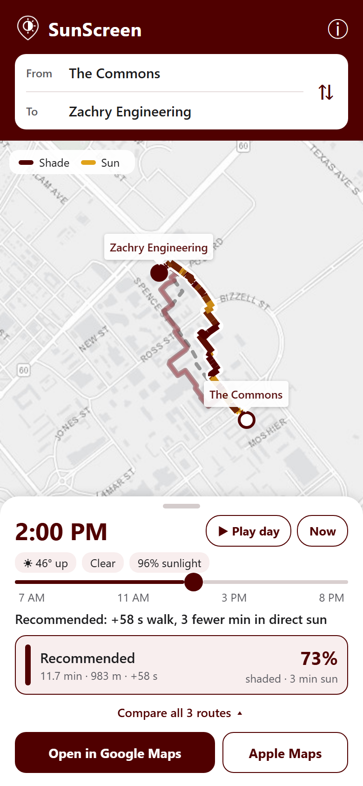 |  | 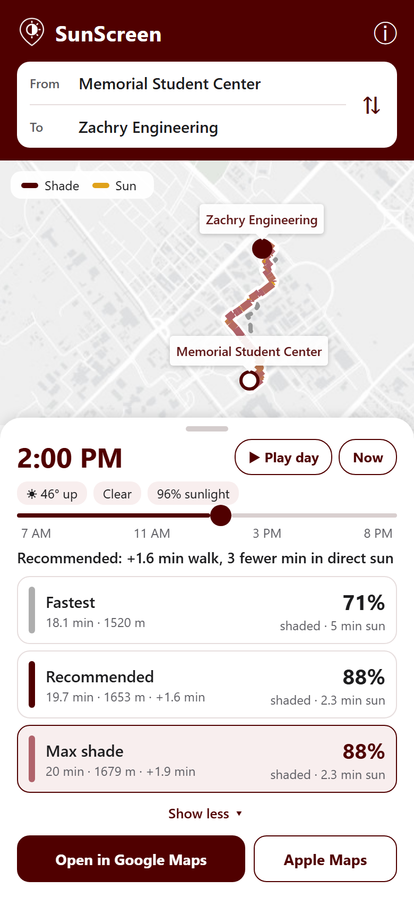 | 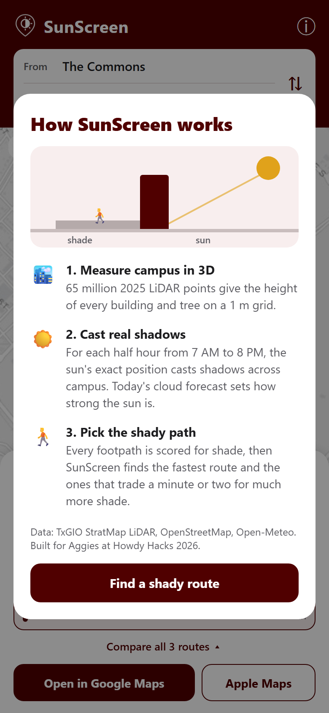 |

## 1. Prototype on the design canvas

Four phone artboards. The source is in [`redesign/`](redesign/); the canvas link is in the table above.

- **Current app (before):** the original screenshot, for comparison.
- **Day · compare routes:** interactive. Floating trip card, round map buttons (night mode, settings, info), sun timeline with Play and Now, three route cards side by side, a one-line summary, and Google Maps / Apple Maps buttons.
- **Night · streetlights:** dark theme with a copper accent, route cards showing the share of each route that is lit, lamps on the map, Corps escort card.
- **Place picker:** search field, My location and Pick on map buttons, category chips, icon tiles, recent places, a check on the current destination.

The prototype used sample route numbers and a hand-drawn map.

## 1b. First in-app build

The prototype built into the React Native app as 7 commits on `ui-redesign`, with `react-native-svg` added for icons. All 21 Chromium browser tests passed. Problems found in the first screenshots and fixed before pushing:

- `·`, `°` and `©` showed as garbled characters after a PowerShell edit re-encoded `App.js`.
- "Recommended" was cut off in its route card at 390 px wide; the cards got tighter spacing and slightly smaller labels.
- On phones the night sheet was so tall the map shrank to a thin strip; the sheet is now capped near 56% of the screen and scrolls.

Pushed to SunScreen-OLD as PR #1, later closed in favour of SunScreen.

## 2. Rebased onto SunScreen `main`

SunScreen's `main` had 16 newer commits: more campus places, building-code search, map place highlights with a place details panel, and a fix that stops the map from re-fitting itself. The redesign was rebased onto it and kept all of that. Changes made during the rebase:

- The place picker kept the new look and took on building-code and alias search plus the residence, health and facilities categories.
- On screens under 700 px tall, the trip card sits above the map instead of floating over it, so it no longer covers the start pin.
- Route cards use smaller text on phones under 360 px wide.
- Taps between the round map buttons reach the map.

32 of 32 Chromium tests passed. Merged as SunScreen PR #8.

| Day, 2:00 PM | Day, timeline set to 9:30 AM | Place picker | Night | Small phone (320×568), night |
| :-: | :-: | :-: | :-: | :-: |
| 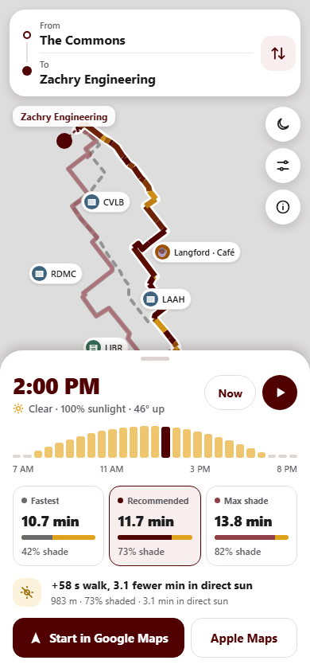 | 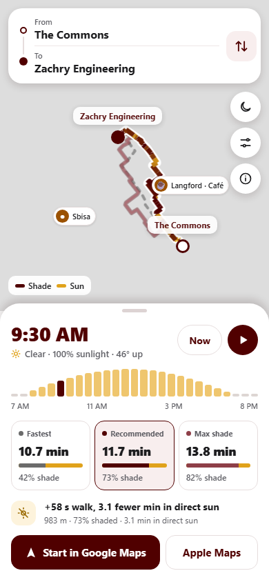 | 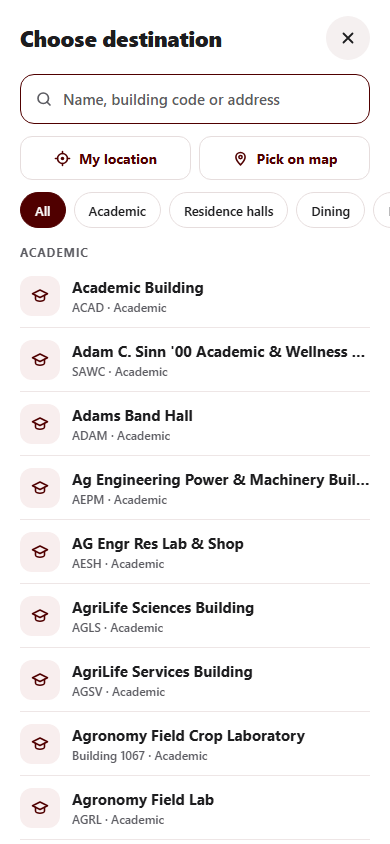 | 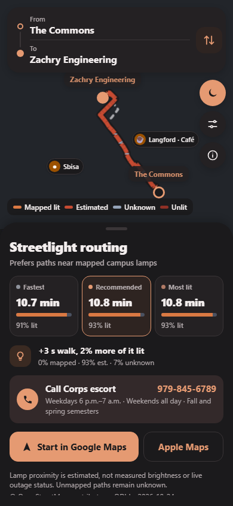 | 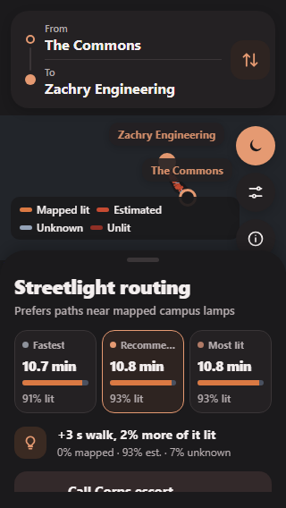 |

The 2:00 PM day shot was taken while the map was still zooming in, so the route runs under the sheet. The settled view fits the whole route.

## 3. Feedback: white space on the desktop panel

On desktop the side panel left a large empty area below the maps buttons. Night mode also had more explanatory text than it needed.

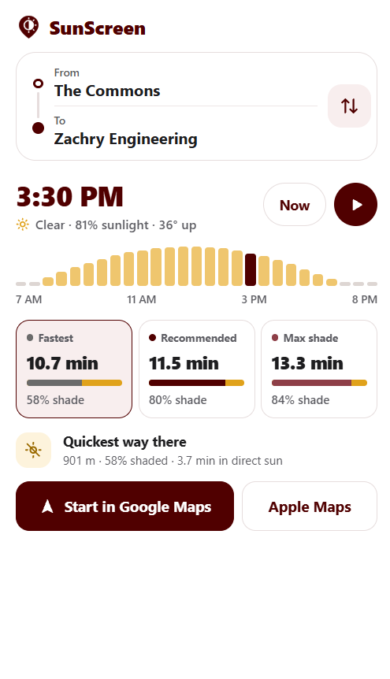

## 4. Desktop fill and shorter night text

- On desktop in day mode, the panel is three groups (time, routes, actions) spread down its height. The sun timeline grows with the window, and route cards add the distance.
- On desktop in night mode, the title, routes and summary stay together at the top, with the escort card and maps buttons at the bottom.
- Night mode dropped its subtitle and the paragraph about lamp estimates. The two source lines became one: "© OpenStreetMap contributors · TAMU campus GIS".

| Desktop, day | Desktop, night | Phone, night |
| :-: | :-: | :-: |
| 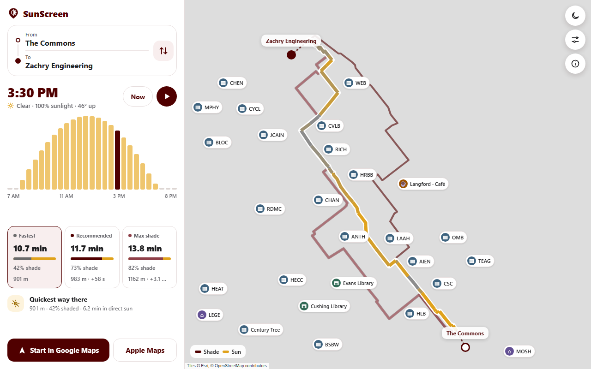 | 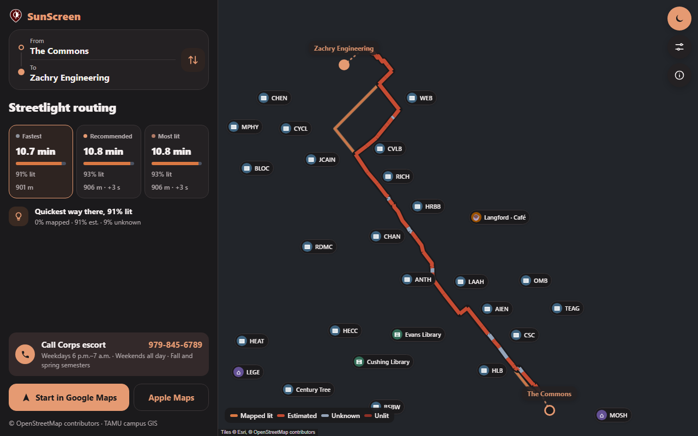 | 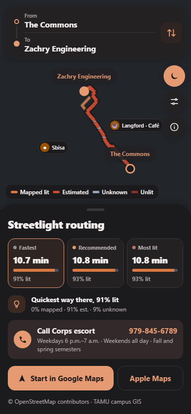 |

These were taken just before the last tweak: the timeline can now grow up to 200 px tall (up from 160), and the cards show distance only, without the extra time.

## 5. README screenshots (current)

Retaken with real map tiles. These are the images the README shows. "Compare all three routes" became "Night mode by streetlights" because all three routes are always visible now.

| Shade vs. sun | Place picker | Night mode | How it works |
| :-: | :-: | :-: | :-: |
| 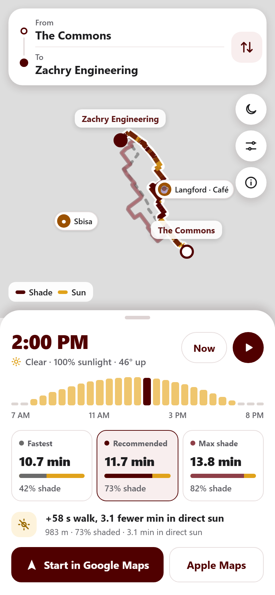 |  | 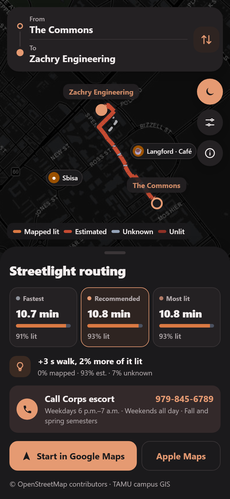 | 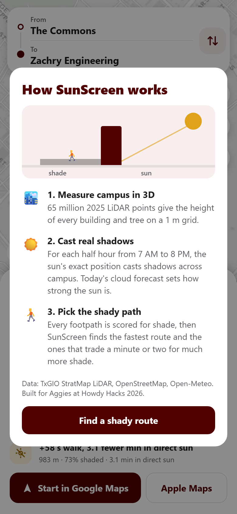 |

## Commits and pull requests

| Repo | What | Ref |
| --- | --- | --- |
| SunScreen-OLD | First build, closed | [PR #1](https://github.com/vignesh-nagarajan-vn/SunScreen-OLD/pull/1) |
| SunScreen | Redesign, 7 commits, merged | [PR #8](https://github.com/vignesh-nagarajan-vn/SunScreen/pull/8) |
| SunScreen `main` | Stretch the desktop panel to fill its height and trim night mode text | `664ef5d` |
| SunScreen `main` | Refresh README screenshots for the redesigned app | `54a8bfa` |
